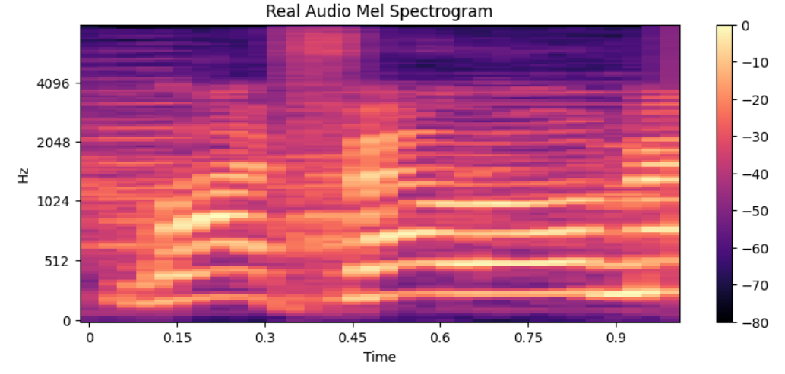
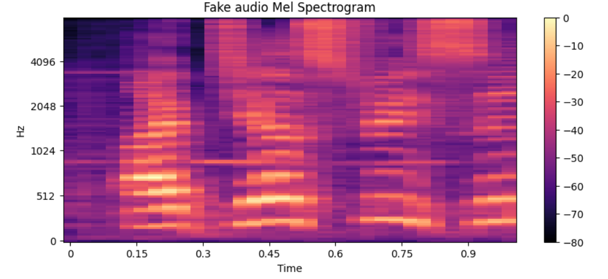
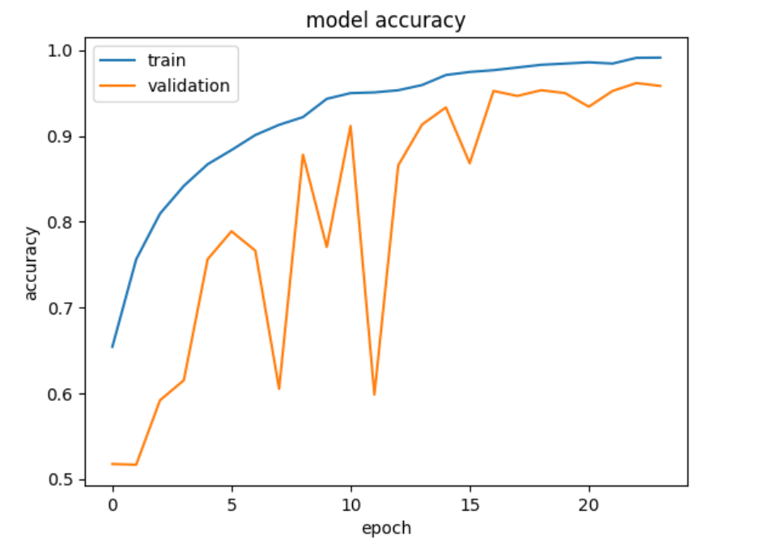
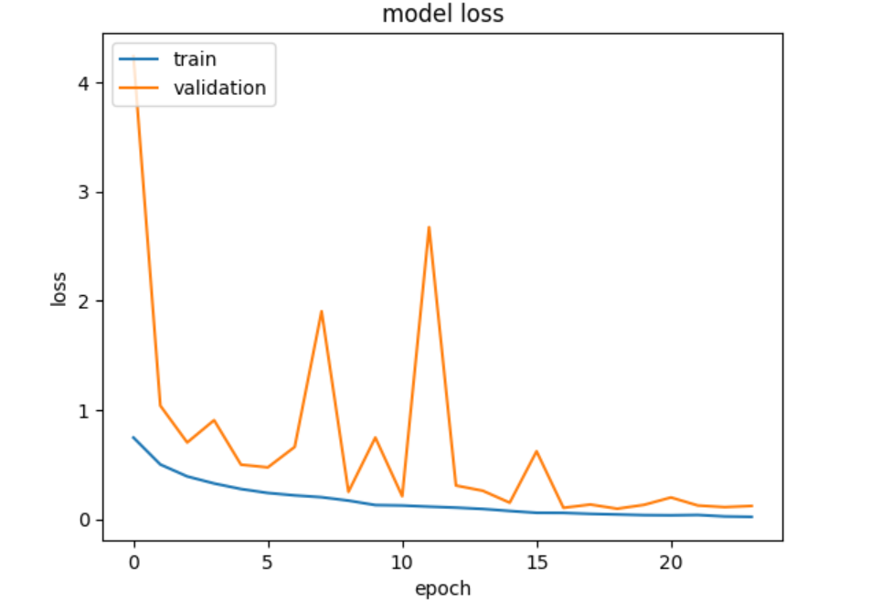
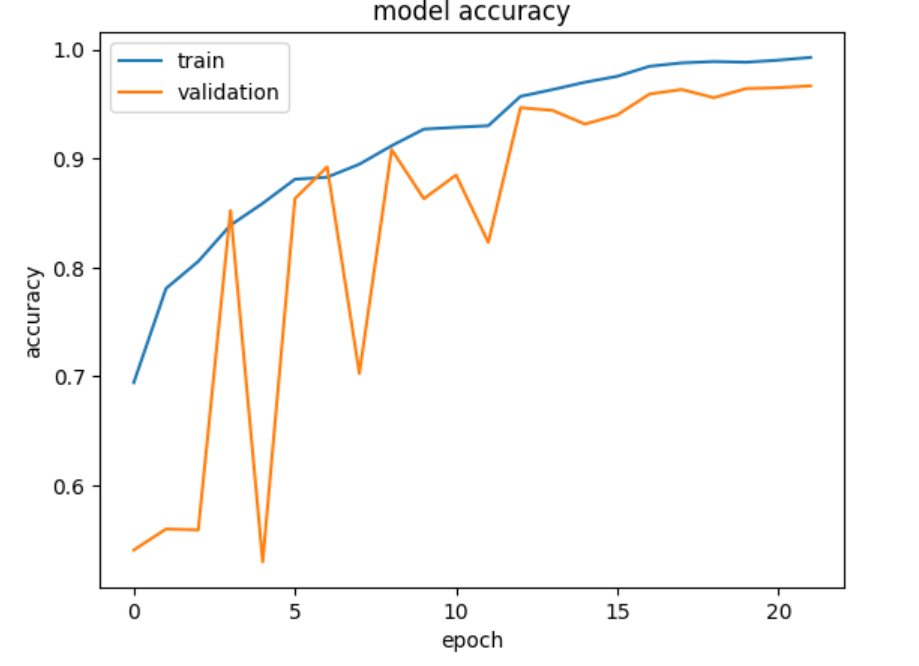
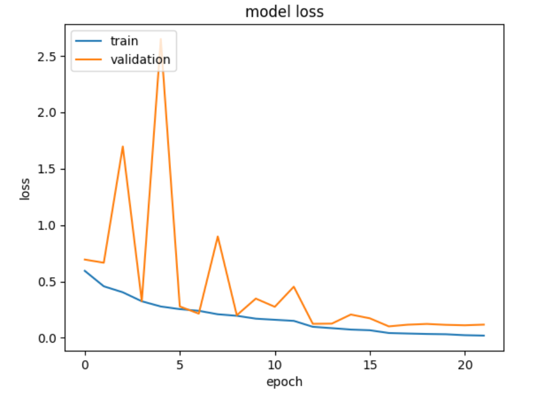

# Deepfake Voice Detection using Mel Spectrograms and CNN

## Problem Statement

The rapid advancement of Generative AI has enabled the creation of highly realistic synthetic voices. Modern voice cloning and deepfake technologies can imitate a person's speech patterns, tone, and pronunciation with remarkable accuracy.

While these technologies have legitimate applications, they also introduce significant risks including:

* Voice impersonation and identity fraud
* Social engineering attacks
* Misinformation and fake media generation
* Unauthorized use of a person's voice

Detecting AI-generated speech has therefore become an important challenge in modern cybersecurity and artificial intelligence.

This project presents an end-to-end Deep Learning solution for detecting deepfake audio using Mel Spectrogram representations and Convolutional Neural Networks (CNNs).

Live Demo = https://deepfake-voice-detector-tawny.vercel.app

---

## Project Overview

The system processes raw audio recordings and classifies them as either:

* REAL Speech
* FAKE (AI-Generated) Speech

The complete pipeline includes:

```text
Raw Audio
    ↓
1-Second Windowing
    ↓
Dataset Balancing
    ↓
Mel Spectrogram Generation
    ↓
dB Scale Conversion
    ↓
Normalization
    ↓
Convolutional Neural Network (CNN)
    ↓
Deepfake Detection
```

The deployed application is split into two parts:

* **frontend/** is the website. Visitors upload a WAV file, or try a sample from the training set, and see a REAL or FAKE result with a confidence score.
* **backend/** is the API. It checks that the request comes from the website, builds the Mel spectrogram, and runs the trained CNN.

The original Streamlit app is still in the repository as `app.py`.

---

## Dataset

The model was trained on the [DEEP-VOICE dataset](https://www.kaggle.com/datasets/birdy654/deep-voice-deepfake-voice-recognition).

### Structure

* REAL audio samples
* FAKE audio samples generated through voice conversion techniques

Recordings used for training belong in:

```text
data/KAGGLE/AUDIO/REAL
data/KAGGLE/AUDIO/FAKE
```

### Processing Strategy

Long audio recordings were divided into 1-second chunks to:

* Increase the number of training samples
* Improve model generalization
* Capture local speech characteristics
* Detect deepfake artifacts more effectively

The website includes two short clips from this dataset:

| Button | File | What it is |
| --- | --- | --- |
| Real sample | `frontend/public/samples/biden.wav` | Biden's original voice |
| Fake sample | `frontend/public/samples/obama-to-biden.wav` | Obama's speech converted into Biden's voice |

The buttons are labeled Real sample and Fake sample. The filenames record which speaker was converted.

---

## Mel Spectrogram Visualization

Mel Spectrograms transform audio signals into image-like representations that capture both temporal and frequency information.

### Real Voice Spectrogram



### Fake Voice Spectrogram



---

## CNN Architectures

Two CNN architectures were evaluated.

### CNN V1

```text
Conv2D(32)
↓
BatchNormalization
↓
MaxPooling

Conv2D(64)
↓
BatchNormalization
↓
MaxPooling

Conv2D(128)
↓
BatchNormalization
↓
MaxPooling

Flatten
↓
Dense(128)
↓
Dense(64)
↓
Dense(1)
```

### CNN V2 (Selected Model)

```text
Conv2D(32)
↓
BatchNormalization
↓
MaxPooling

Conv2D(64)
↓
BatchNormalization
↓
MaxPooling

Conv2D(128)
↓
BatchNormalization
↓
MaxPooling

Conv2D(256)
↓
BatchNormalization
↓
MaxPooling

Flatten
↓
Dense(128)
↓
Dense(64)
↓
Dense(1)
```

Inference rebuilds CNN V2 and loads `backend/models/weights_best_2.weights.h5`. The weight file is not stored in this repository. Place it in that folder before starting the API.

---

## Training Curves

### CNN V1 Accuracy



### CNN V1 Loss



### CNN V2 Accuracy



### CNN V2 Loss



---

## Model Performance

| Metric    | CNN V1 | CNN V2 |
| --------- | ------ | ------ |
| Accuracy  | 96.19% | 96.39% |
| Precision | 96%    | 96%    |
| Recall    | 96%    | 96%    |
| F1 Score  | 96%    | 96%    |

CNN V2 was selected as the final model due to its slightly improved performance and lower validation loss.

---

## Confusion Matrix

```text
[[730  19]
 [ 35 713]]
```

Classification Report:

```text
Precision : 96%
Recall    : 96%
F1 Score  : 96%
Accuracy  : 96.39%
```

---

## Web Application

Visitors can:

* Upload a WAV file of at least 1 second, up to 25 MB
* Play the selected audio
* Try the real and fake training samples
* Receive a REAL or FAKE prediction
* View the model confidence score

The page sends the audio to `POST /predict`. The API only scores a request whose browser origin is listed in `CORS_ORIGINS`. A request from another site receives `403` and the model does not run. `GET /health` stays open so the host can check that the service is up.

### Deploy the API on Render

Create a Web Service from this repository:

* Root Directory: `backend`
* Build command: `pip install -r requirements.txt`
* Start command: `python -m uvicorn main:app --host 0.0.0.0 --port $PORT`

Set this environment variable on Render:

```text
PYTHON_VERSION=3.11.11 
```

```text
CORS_ORIGINS=https://your-app.vercel.app
```

Use the exact site address, with no trailing slash. `*` is rejected. For a local site and the deployed site together, separate the addresses with a comma:

```text
CORS_ORIGINS=https://your-app.vercel.app,http://127.0.0.1:5173
```

The service needs the weight file at `backend/models/weights_best_2.weights.h5`. TensorFlow needs an instance with at least 2 GB of RAM.

### Deploy the website on Vercel

In the Vercel project:

* Root Directory: `frontend`
* Environment variable: `VITE_API_BASE_URL=https://your-api.onrender.com`

Use the Render address with no trailing slash. Vercel reads that variable while it builds the site. The page does not ask visitors for the API address.

---

## Technologies Used

* Python 3.11 or 3.12
* TensorFlow / Keras
* Librosa
* NumPy
* FastAPI
* Vite
* Vercel
* Render
* Streamlit, for the original local app

TensorFlow 2.16 does not run on Python 3.13.

---

## Project Structure

```text
Deepfake-Voice-Detection/
├── frontend/
│   ├── index.html
│   ├── app.js
│   ├── styles.css
│   ├── public/samples/
│   │   ├── biden.wav
│   │   └── obama-to-biden.wav
│   ├── .env.example
│   └── package.json
├── backend/
│   ├── main.py
│   ├── origin_guard.py
│   ├── requirements.txt
│   ├── runtime.txt
│   ├── Procfile
│   ├── .env.example
│   ├── models/
│   │   └── weights_best_2.weights.h5
│   └── src/
│       ├── config.py
│       ├── preprocess.py
│       └── predict.py
├── app.py
├── src/
├── notebooks/
├── assets/
├── data/
├── download_dataset.py
├── render.yaml
└── README.md
```

`backend/.env` and `frontend/.env` are listed in `.gitignore`, so local addresses are not committed. Copy each `.env.example` file to `.env` when running on your own machine.

---

## Results

The proposed Deepfake Voice Detection system successfully achieved:

* 96.39% Test Accuracy
* 96% Precision
* 96% Recall
* 96% F1 Score

The project demonstrates that Mel Spectrograms combined with CNN-based feature extraction can effectively identify AI-generated speech from real human speech.

---

## Run the API locally

Clone the repository:

```bash
git clone https://github.com/Sudhanshu-Roy/Deepfake-Voice-Detection.git
cd Deepfake-Voice-Detection
```

Use Python 3.11 or 3.12:

```bash
cd backend
python -m venv venv
```

### Windows

```bash
venv\Scripts\activate
```

### Linux / macOS

```bash
source venv/bin/activate
```

Install the API dependencies and add the weight file:

```bash
pip install -r requirements.txt
```

Place `weights_best_2.weights.h5` in `backend/models/`. Then create the local environment file:

```bash
copy .env.example .env
```

On Linux or macOS, use `cp .env.example .env`. Set `CORS_ORIGINS` to the local website address:

```text
CORS_ORIGINS=http://127.0.0.1:5173,http://localhost:5173
```

Start the API:

```bash
python -m uvicorn main:app --host 127.0.0.1 --port 8000
```

`GET http://127.0.0.1:8000/health` returns `{"status":"ok"}` when the server is ready.

---

## Run the website locally

From `frontend/`:

```bash
npm install
copy .env.example .env
```

Set the API address:

```text
VITE_API_BASE_URL=http://127.0.0.1:8000
```

Start the site:

```bash
npm run dev
```

Open http://127.0.0.1:5173/. The dev server prints the exact address.

---

## Original Streamlit app

`app.py` is the original single-file interface. It expects the same weight file at `models/weights_best_2.weights.h5` in the repository root and uses the packages in the root `requirements.txt`.

```bash
pip install -r requirements.txt
streamlit run app.py
```

---

## Download Dataset

### Automatic Download

```bash
pip install kagglehub
```

```python
import kagglehub

path = kagglehub.dataset_download(
    "birdy654/deep-voice-deepfake-voice-recognition"
)

print("Path to dataset files:", path)
```

### Manual Download

Download directly from Kaggle:

https://www.kaggle.com/datasets/birdy654/deep-voice-deepfake-voice-recognition

Place the extracted `KAGGLE/AUDIO` folders inside `data/` before training.

---

## Future Improvements

* Real-time microphone-based detection
* Audio augmentation techniques
* Transformer-based audio architectures
* Explainable AI for audio classification
* Multi-class deepfake source identification

---

## Author

**Sudhanshu Roy**

---

## Support

If you found this project useful, consider giving it a star on GitHub. It helps others discover the project and motivates future improvements.
